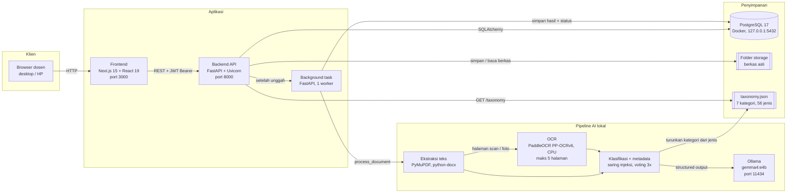
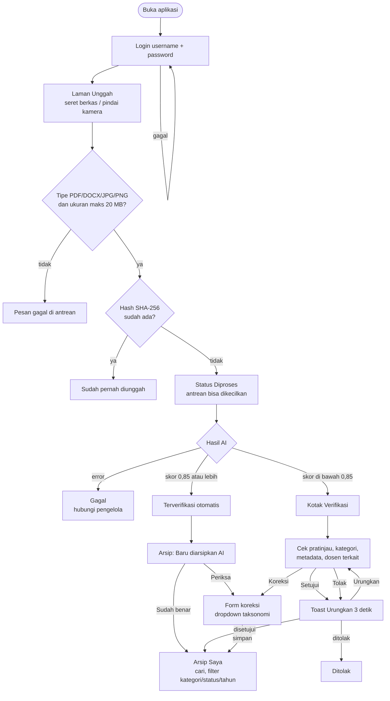
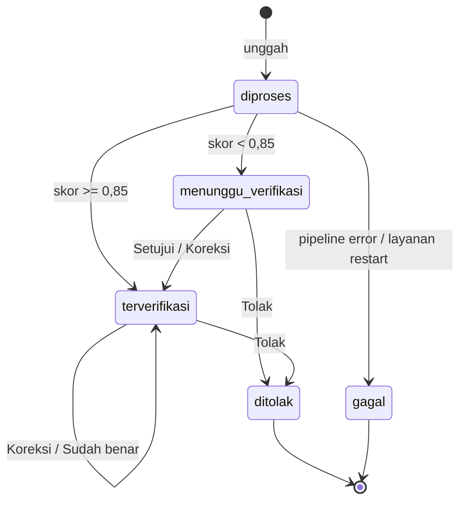
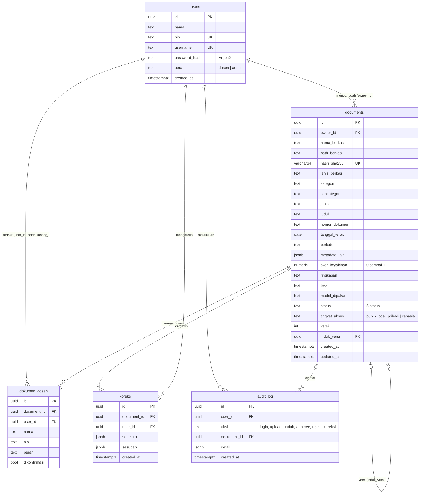
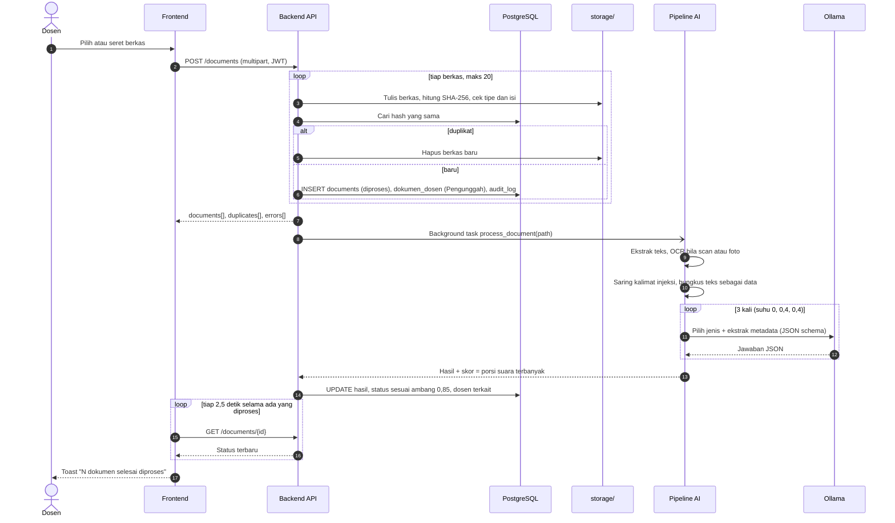
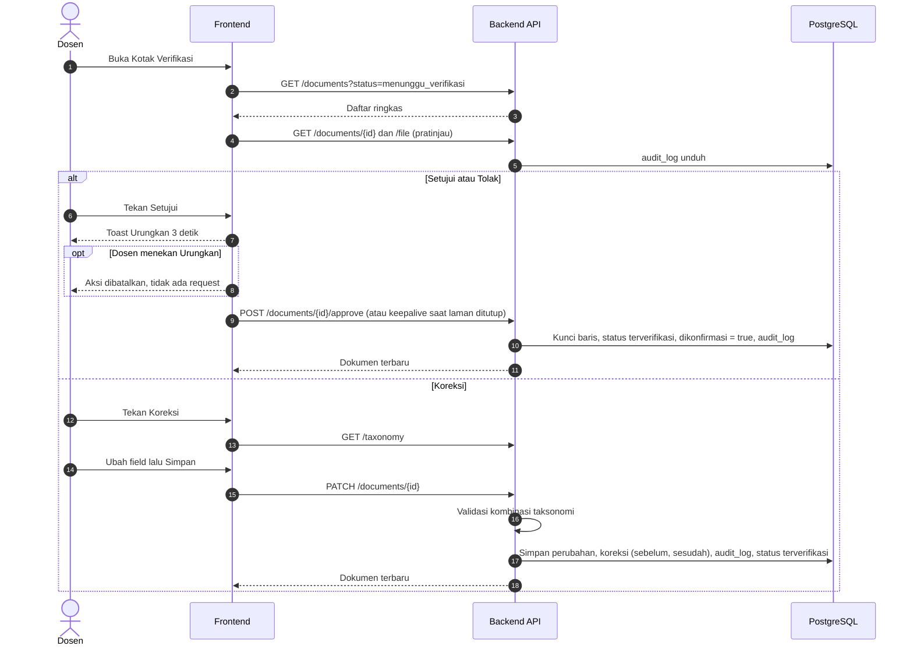

# Arsitektur Sistem AI-DMC (MVP)

Diagram di bawah digambar dari kode yang berjalan per 21 November 2026 (branch `feat/ai-asli-dan-perbaikan-ui`). Semua komponen jalan di satu mesin; tidak ada layanan AI publik.

## 1. Arsitektur sistem

## 2. Alur pengguna (dosen)

## 3. Status dokumen

## 4. ERD

Catatan: `audit_log` dijaga trigger database sehingga tidak bisa di-UPDATE, DELETE, atau TRUNCATE dari aplikasi.

## 5. Sequence: unggah dan proses AI

## 6. Sequence: verifikasi

