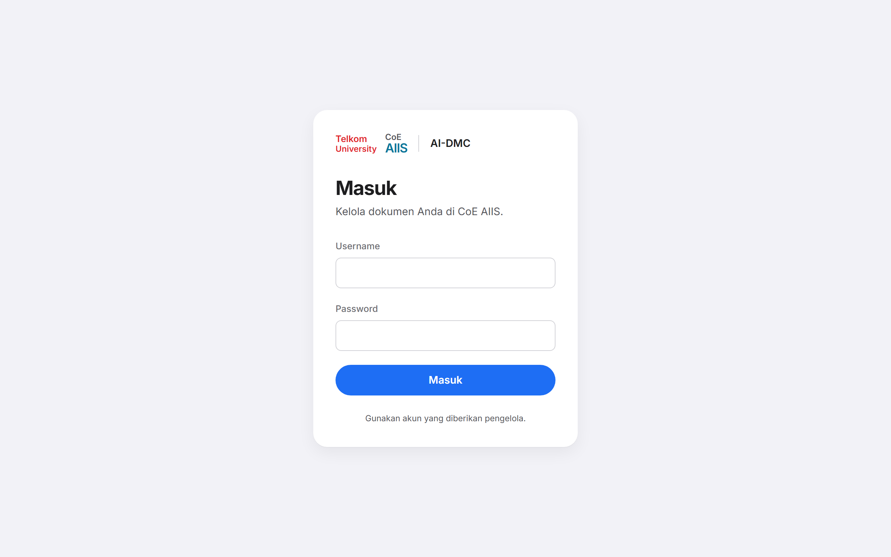
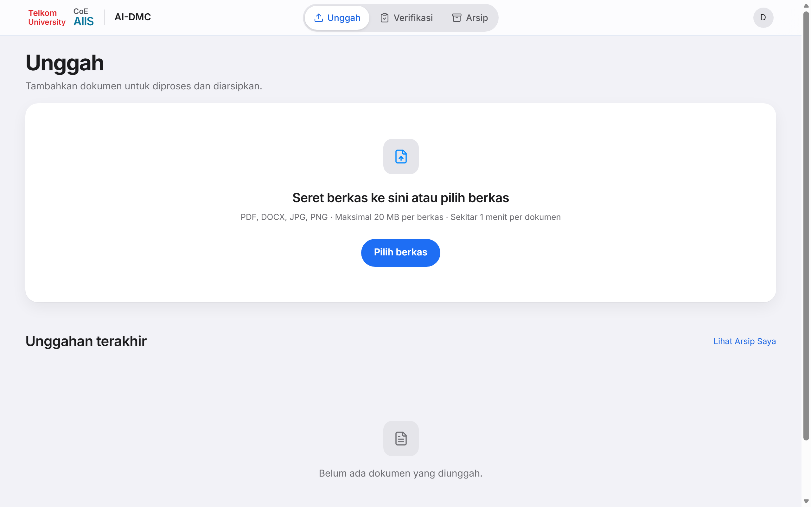
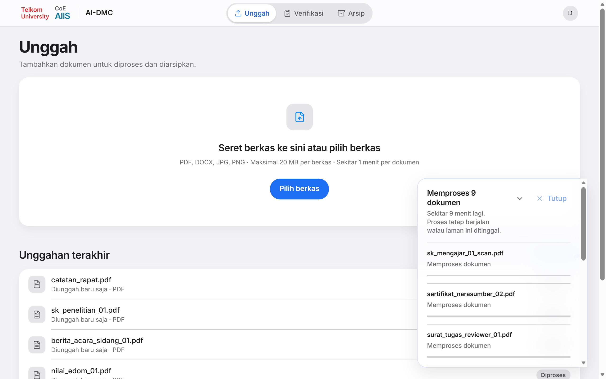
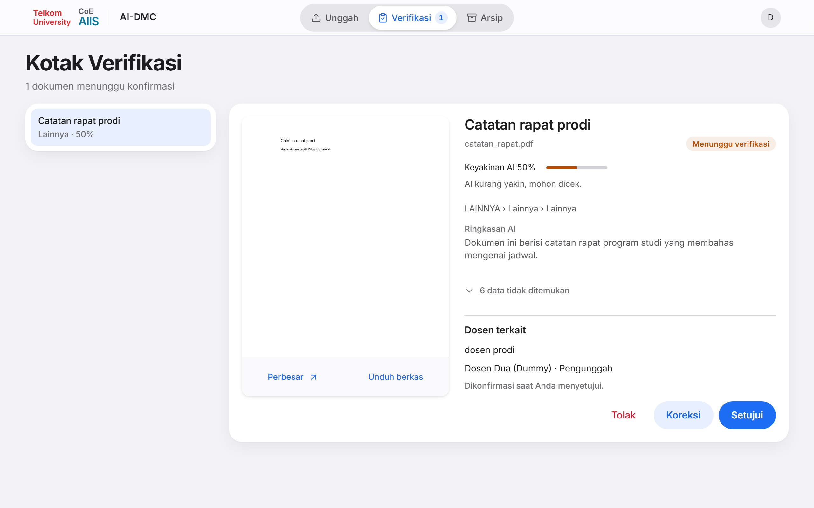
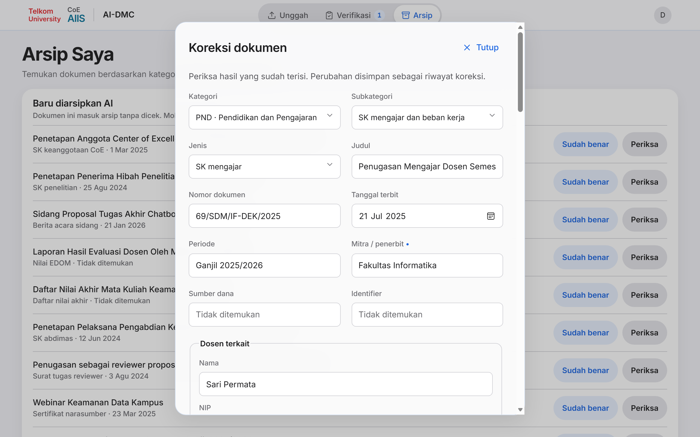
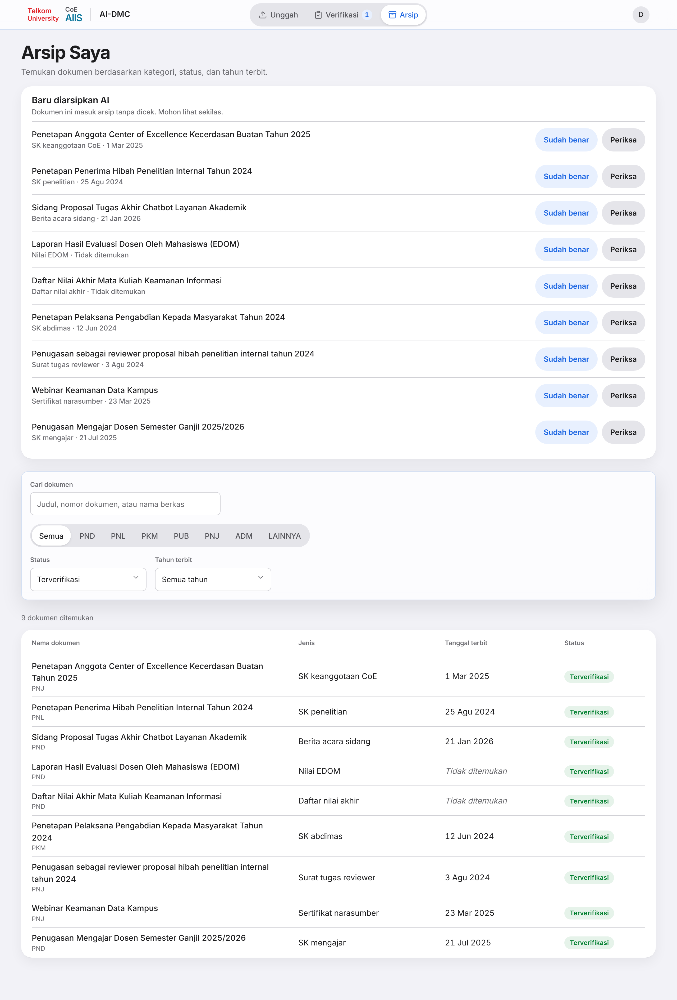
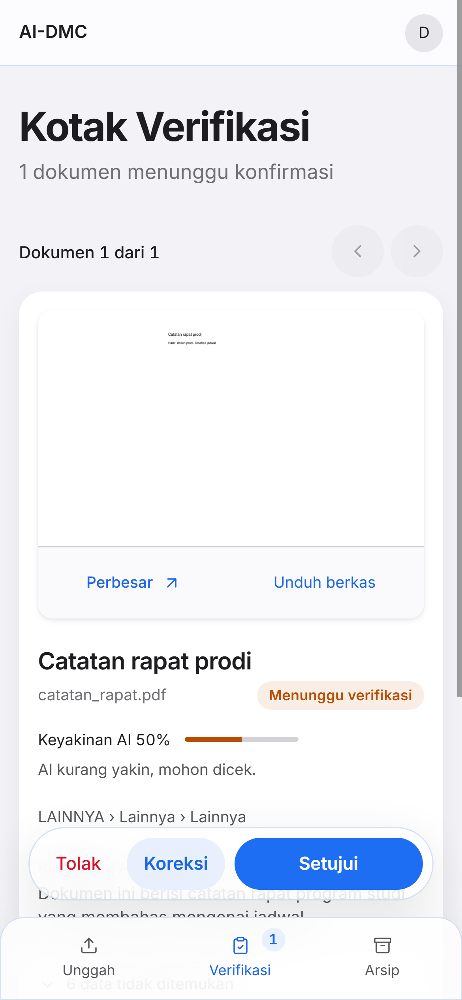

# Buku Panduan Dosen AI-DMC

AI Document Management Center, CoE AIIS Telkom University
Versi uji coba, November 2026

## Daftar isi

1. Mengenal AI-DMC
2. Masuk ke aplikasi
3. Mengunggah dokumen
4. Memeriksa hasil di Kotak Verifikasi
5. Mengoreksi hasil AI
6. Mencari dokumen di Arsip Saya
7. Arti status dokumen
8. Kategori dokumen
9. Pertanyaan yang sering muncul
10. Keamanan dan privasi

---

## 1. Mengenal AI-DMC

AI-DMC menyimpan dokumen eviden dosen di satu tempat: SK, surat tugas, sertifikat, RPS, daftar nilai, laporan, dan lainnya.

Cara kerjanya:

1. Anda mengunggah dokumen.
2. AI membaca dokumen, menentukan jenisnya, dan mengisi data penting seperti judul, nomor, tanggal terbit, periode, dan dosen terkait.
3. Kalau AI yakin, dokumen langsung masuk arsip. Kalau AI kurang yakin, dokumen menunggu Anda periksa di Kotak Verifikasi.
4. Anda cukup menyetujui, mengoreksi, atau menolak.

AI berjalan di server kampus. Dokumen Anda tidak dikirim ke layanan AI di internet.

Aplikasi punya tiga laman, bisa dibuka dari menu di atas (komputer) atau di bawah (HP):

| Laman | Untuk apa |
|---|---|
| **Unggah** | Menambah dokumen baru |
| **Verifikasi** | Memeriksa hasil AI yang kurang yakin. Angka di menu menunjukkan jumlah dokumen yang menunggu |
| **Arsip** | Mencari dan membuka dokumen yang sudah tersimpan |

## 2. Masuk ke aplikasi

1. Buka alamat aplikasi yang diberikan pengelola.
2. Isi **Username** dan **Password**, lalu tekan **Masuk**.
3. Setelah berhasil, Anda langsung dibawa ke laman Unggah.

Hal yang perlu diketahui:

- Akun dibuat oleh pengelola. Hubungi pengelola kalau belum punya akun atau lupa password.
- Sesi berlaku 60 menit. Setelah itu Anda diminta masuk lagi.
- Menutup tab browser juga mengakhiri sesi.
- Untuk keluar, tekan lingkaran berisi huruf awal nama Anda di pojok kanan atas, lalu **Keluar**. Selalu keluar setelah memakai komputer bersama.

## 3. Mengunggah dokumen

### Cara mengunggah

1. Buka laman **Unggah**.
2. Pilih salah satu:
   - **Seret berkas** dari folder komputer ke kotak unggah, atau
   - Tekan **Pilih berkas**, lalu pilih satu atau beberapa berkas sekaligus, atau
   - Di HP, tekan **Pindai dengan kamera** untuk memotret dokumen kertas.
3. Berkas masuk ke panel **Antrean unggah** dan diproses AI.

Ketentuan berkas:

- Format: **PDF, DOCX, JPG, PNG**.
- Ukuran maksimal **20 MB per berkas**.
- Maksimal **20 berkas** dalam satu kali unggah.
- Satu berkas berisi satu dokumen. Jangan menggabungkan beberapa SK dalam satu PDF.

### Lama proses

- Sekitar 1 menit per dokumen. Dokumen hasil scan atau foto bisa lebih lama karena teksnya harus dibaca dari gambar.
- **Proses tetap berjalan walau laman ditinggal.** Anda boleh pindah laman atau mengerjakan hal lain.
- Panel antrean bisa dikecilkan dengan tombol panah supaya tidak menutupi layar.
- Setelah semua selesai, muncul pemberitahuan, misalnya "3 dokumen selesai diproses. 1 perlu dicek", dengan tombol menuju Kotak Verifikasi atau Arsip Saya.

### Arti keterangan di antrean

| Keterangan | Artinya |
|---|---|
| Mengunggah | Berkas sedang dikirim |
| Memproses dokumen | AI sedang membaca dokumen |
| Selesai | Dokumen langsung masuk arsip |
| Selesai · Perlu verifikasi | Dokumen menunggu Anda periksa di Kotak Verifikasi |
| Sudah pernah diunggah | Berkas yang persis sama sudah ada di sistem. Tidak disimpan dua kali |
| Gunakan PDF, DOCX, JPG, atau PNG | Format berkas tidak didukung |
| Ukuran maksimal 20 MB per berkas | Berkas terlalu besar. Perkecil dulu, misalnya dengan scan ulang resolusi lebih rendah |

Lima unggahan terbaru tampil di bagian **Unggahan terakhir**.

### Tips agar hasil AI akurat

- Utamakan **PDF asli** (hasil unduhan dari sistem kampus), bukan hasil scan.
- Kalau harus scan atau foto: dokumen lurus, terang, tidak terpotong, dan tulisan terbaca jelas.
- Halaman pertama yang memuat judul, nomor, dan tanggal adalah yang paling penting.

## 4. Memeriksa hasil di Kotak Verifikasi

Buka laman **Verifikasi**. Dokumen yang menunggu tampil di daftar kiri. Pilih salah satu, atau pakai tombol panah untuk berpindah dokumen.

Untuk setiap dokumen, cocokkan pratinjau dengan hasil AI:

| Bagian | Yang dicek |
|---|---|
| **Pratinjau** | Isi dokumen asli. Tekan **Perbesar** untuk melihat lebih jelas, atau **Unduh berkas** |
| **Keyakinan AI** | Persentase keyakinan. Keterangan "AI kurang yakin, mohon dicek" berarti periksa lebih teliti |
| **Kategori › Subkategori › Jenis** | Apakah jenis dokumen sudah tepat |
| **Ringkasan AI** | Gambaran singkat isi dokumen |
| **Data** | Nomor dokumen, tanggal terbit, periode, dan lainnya |
| **N data tidak ditemukan** | Data yang tidak tertulis di dokumen. Tekan untuk melihat daftarnya |
| **Dosen terkait** | Nama dosen dan perannya (pengajar, pembimbing, penguji, dan sebagainya) |

AI tidak mengarang data. Kalau suatu data tidak tertulis di dokumen, isinya **Tidak ditemukan**.

Lalu pilih salah satu tombol:

| Tombol | Kapan dipakai | Hasilnya |
|---|---|---|
| **Setujui** | Semua hasil sudah benar | Dokumen masuk arsip, dosen terkait dikonfirmasi |
| **Koreksi** | Ada yang salah atau kurang | Form koreksi terbuka (lihat Bagian 5) |
| **Tolak** | Berkas bukan dokumen eviden, salah unggah, atau rusak | Dokumen ditandai Ditolak |

Setelah menekan Setujui atau Tolak, muncul pemberitahuan dengan tombol **Urungkan** selama 3 detik. Tekan Urungkan kalau salah pencet. Setelah 3 detik aksi disimpan. Kalau laman ditutup sebelum 3 detik habis, aksi tetap disimpan.

### Dokumen yang langsung masuk arsip

Dokumen yang AI yakini benar langsung tersimpan tanpa lewat Kotak Verifikasi. Dokumen ini muncul di bagian **Baru diarsipkan AI** di laman Arsip. Mohon lihat sekilas:

- **Sudah benar**: dokumen dikonfirmasi dan hilang dari daftar ini.
- **Periksa**: membuka form koreksi.

## 5. Mengoreksi hasil AI

Form koreksi terbuka dari tombol **Koreksi** (Kotak Verifikasi) atau **Periksa** (Arsip).

1. Pilih **Kategori**, lalu **Subkategori**, lalu **Jenis** dari daftar. Mengganti kategori akan mengosongkan subkategori dan jenis, jadi pilih ulang keduanya.
2. Perbaiki data lain: judul, nomor dokumen, tanggal terbit (pilih dari kalender), periode, mitra atau penerbit, sumber dana, identifier (DOI, ISSN, ISBN).
3. Di bagian **Dosen terkait**, ubah nama, NIP, atau peran. Tekan **Tambah dosen terkait** untuk menambah, atau **Hapus dosen** untuk menghapus.
4. Field yang sudah Anda ubah ditandai titik (•).
5. Tekan **Simpan dan setujui**. Dokumen langsung berstatus Terverifikasi.

Tekan **Batal** untuk keluar. Kalau ada perubahan yang belum disimpan, aplikasi menanyakan apakah perubahan akan dibuang.

Setiap koreksi disimpan sebagai riwayat dan dipakai untuk memperbaiki ketepatan AI ke depannya.

Contoh format periode: `Ganjil 2025/2026` atau `Genap 2025/2026`.

## 6. Mencari dokumen di Arsip Saya

Buka laman **Arsip**. Secara bawaan, yang tampil adalah dokumen berstatus **Terverifikasi**.

- **Cari dokumen**: ketik judul, nomor dokumen, nama berkas, jenis, atau periode. Beberapa kata sekaligus juga bisa, misalnya `SK mengajar 2025/2026`.
- **Kategori**: tekan kode kategori (PND, PNL, PKM, PUB, PNJ, ADM, LAINNYA) atau **Semua**.
- **Filter** (di HP, tekan tombol Filter dulu):
  - **Status**: pilih Semua status untuk melihat juga dokumen yang menunggu verifikasi, ditolak, atau gagal.
  - **Tahun terbit**: tahun pada tanggal terbit dokumen.
- Tekan nama dokumen untuk membuka pratinjau dan mengunduh berkasnya. Berkas DOCX tidak bisa dipratinjau, tapi bisa diunduh.

## 7. Arti status dokumen

| Status | Artinya | Yang perlu dilakukan |
|---|---|---|
| **Diproses** | AI sedang membaca dokumen | Tunggu |
| **Menunggu verifikasi** | AI kurang yakin | Periksa di Kotak Verifikasi |
| **Terverifikasi** | Tersimpan di arsip | Tidak ada. Masih bisa dikoreksi lewat Periksa |
| **Ditolak** | Ditolak oleh Anda | Tidak ada. Status ini final |
| **Gagal** | Dokumen tidak bisa diproses | Hubungi pengelola (lihat Bagian 9) |

## 8. Kategori dokumen

| Kode | Kategori | Contoh |
|---|---|---|
| PND | Pendidikan dan Pengajaran | SK mengajar, RPS, daftar nilai, SK pembimbing dan penguji TA |
| PNL | Penelitian | SK penelitian, proposal dan laporan penelitian, kontrak hibah |
| PKM | Pengabdian kepada Masyarakat | SK abdimas, proposal dan laporan abdimas, surat kesediaan mitra |
| PUB | Publikasi dan HKI | Artikel jurnal, prosiding, LoA, sertifikat HKI dan paten |
| PNJ | Penunjang | SK kepanitiaan, sertifikat narasumber, surat tugas reviewer dan asesor |
| ADM | Administrasi Kepegawaian dan Kualifikasi | SK jabatan fungsional, SK pangkat, ijazah, sertifikat kompetensi |
| LAINNYA | Lainnya | Dokumen yang tidak cocok dengan kategori lain |

Daftar jenis lengkap tersedia di menu pilihan form koreksi. Pembagian kategori masih bisa disesuaikan oleh Admin CoE.

## 9. Pertanyaan yang sering muncul

**Dokumen saya berstatus Gagal. Apa yang harus dilakukan?**
Biasanya karena berkas rusak, terkunci password, tidak ada teks yang terbaca (misalnya scan terlalu buram), atau server sedang dimulai ulang. Hubungi pengelola dengan menyebut nama berkas dan waktu unggah. Mengunggah ulang berkas yang sama saat ini ditolak dengan keterangan "Sudah pernah diunggah", jadi pengelola yang akan memproses ulang.

**Muncul "Sudah pernah diunggah", padahal saya belum pernah mengunggahnya.**
Berkas yang persis sama mungkin sudah diunggah dosen lain, misalnya SK bersama. Hubungi pengelola agar dokumen itu ditautkan ke akun Anda.

**Hasil AI salah, tapi dokumen sudah masuk arsip.**
Buka Arsip, cari dokumennya di bagian Baru diarsipkan AI lalu tekan Periksa, dan perbaiki lewat form koreksi.

**Saya salah menolak dokumen.**
Status Ditolak bersifat final dan tidak bisa dibatalkan setelah lewat 3 detik. Hubungi pengelola.

**Berapa lama dokumen saya diproses?**
Sekitar 1 menit per dokumen, lebih lama untuk scan atau foto, dan lebih lama lagi kalau banyak dosen mengunggah bersamaan. Anda tidak perlu menunggu di laman Unggah.

**Apakah bisa dipakai di HP?**
Bisa. Menu ada di bagian bawah layar, dan tombol Pindai dengan kamera bisa memotret dokumen kertas langsung.

**Tiba-tiba kembali ke laman Masuk.**
Sesi berakhir setelah 60 menit atau setelah tab ditutup. Masuk kembali. Dokumen yang sedang diproses tidak hilang.

## 10. Keamanan dan privasi

- Dokumen hanya bisa dilihat oleh pengunggahnya. Dosen lain yang disebut di dokumen (dosen terkait) baru bisa melihatnya setelah Anda menyetujui, kecuali dokumen bertingkat akses rahasia.
- Hanya pengunggah yang bisa menyetujui, menolak, atau mengoreksi dokumen. Dosen terkait hanya bisa melihat dan mengunduh.
- Periksa daftar **Dosen terkait** sebelum menyetujui. Hapus nama yang tidak seharusnya ada.
- AI berjalan di server kampus. Tidak ada dokumen yang dikirim ke layanan AI di internet.
- Setiap unggah, unduh, persetujuan, penolakan, dan koreksi tercatat di log audit.
- Jangan bagikan password Anda. Jangan kirim dokumen pribadi atau password lewat grup chat saat melaporkan masalah.
- Keluar dari akun setelah memakai komputer bersama.
- Tetap periksa hasil AI sebelum memakai data untuk keperluan administrasi resmi.

---

Kontak pengelola: (diisi saat uji coba)
